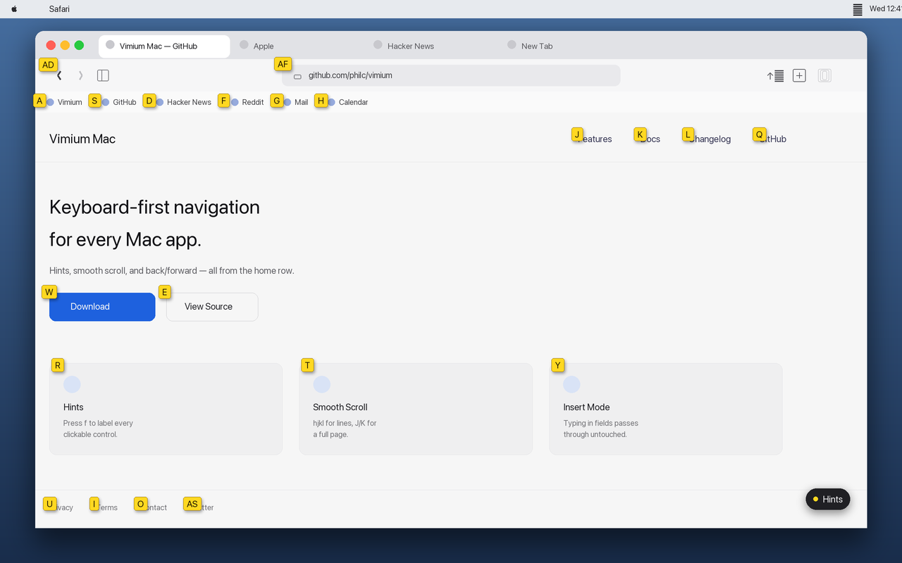

# Vimium Mac

Keyboard navigation for macOS, in the spirit of the [Vimium](https://github.com/philc/vimium) browser extension.

Hint labels, Vim-style scrolling, and back/forward work in **Finder, Safari, Firefox, Chrome, Discord, Preview, Mail, Notes, System Settings**, and other Mac apps — not only in a web page.

This is a **native menubar app**, not a browser extension. There is no Dock icon. After launch, look for a keyboard extra on the right side of the menu bar.




*Simulated illustration of hint mode (pressing `f`) in Finder and Safari — labels appear over clickable controls in the frontmost app. Not an actual screen capture.*

## Features

- **Hints** (`f`) — label clickable controls and activate one from the keyboard
- **Smooth scroll** — `hjkl` for lines, `J`/`K` for a full page, `d`/`u` for half a page
- **History** — `H` / `L` send the standard macOS back/forward shortcuts (`⌘[` / `⌘]`)
- **Insert mode** — typing in a text field is passed through; `Esc` returns to normal
- **Per-app toggle** — disable Vimium Mac in the frontmost app from the menu bar

## Keybindings

Normal mode (no text field focused):

| Keys | Action |
|------|--------|
| `h` `j` `k` `l` | Scroll left / down / up / right |
| `J` `K` | Full page down / up |
| `d` `u` | Half-page down / up |
| `gg` `G` | Top / bottom (`⌘↑` / `⌘↓`) |
| `H` `L` | Back / forward (`⌘[` / `⌘]`) |
| `r` | Reload (`⌘R`) |
| `f` | Hints — click |
| `F` | Hints — ⌘-click |
| `yf` | Hints — copy URL or title |
| `i` | Insert mode (pass keys through) |
| `Esc` | Leave hints or insert |
| `5j` | Repeat a scroll command |

Focused text fields enter insert automatically. `Esc` stays in normal until focus changes or you press `i`.

Global pause: **⌃⌥⇧V**, or **Pause Vimium Mac** in the menu.

## Where it runs

**On by default:** Safari, Firefox, Chrome, Arc, Brave, Edge, Discord, Finder, Preview, Mail, Notes, System Settings, and most other apps.

**Off by default** (so those apps keep their own keys):

- Terminal, iTerm, Alacritty, Kitty, Warp, WezTerm
- VS Code, Cursor, JetBrains, MacVim, TextMate

Enable or disable the frontmost app from the menu bar.

## Install from source

Requires **macOS 13+**, **Xcode 15+**, and [XcodeGen](https://github.com/yonaskolb/XcodeGen):

```bash
brew install xcodegen
```

```bash
cd macos
make install
open "/Applications/Vimium Mac.app"
```

`make install` builds a Release app and copies it to **`/Applications/Vimium Mac.app`**. Use that copy so System Settings keeps a stable Accessibility entry across rebuilds.

Other targets (from `macos/`):

```bash
make          # build only
make run      # build and open the app from the build folder
make clean    # delete DerivedData
```

To open the Xcode project:

```bash
cd macos/VimiumMac
xcodegen generate
open VimiumMac.xcodeproj
```

The App Sandbox is off (required for a global key tap and Accessibility access to other apps). This is not App Store–friendly.

## First launch

1. A settings window opens once. A keyboard icon stays in the **menu bar**.
2. Grant **Accessibility** when macOS asks, or use **Open Accessibility Settings** in that window.
3. System Settings → Privacy & Security → Accessibility → enable **Vimium Mac**.
4. Try **Finder** or **Safari**: `j`/`k` to scroll, `f` for hints.

If the extra is missing, check the menu bar overflow (`»`). Closing the window does not quit; choose **Show Window** from the extra. **Quit Vimium Mac** is in that same menu.

**Launch at Login** is optional, from the window or the extra.

If keys are not captured after Accessibility is on, also enable Vimium Mac under Privacy & Security → **Input Monitoring**.


## Limitations

- Hints come from the macOS Accessibility tree. Custom-drawn controls with no role may not get a label.
- Firefox, Chrome, and Electron apps (Discord) need Accessibility granted. Vimium Mac then enables each app’s accessibility so page content can appear as hints; otherwise you mostly see window chrome. Focus the app and press `f` once.
- Editors that are also Electron apps (VS Code, Cursor) stay excluded so `hjkl` does not steal editor keys.
- Ad-hoc signed rebuilds from the build folder can look like a new app to System Settings. Prefer `make install` and `/Applications/Vimium Mac.app`.

## License

Inspired by [Vimium](https://github.com/philc/vimium). See [MIT-LICENSE.txt](MIT-LICENSE.txt).
