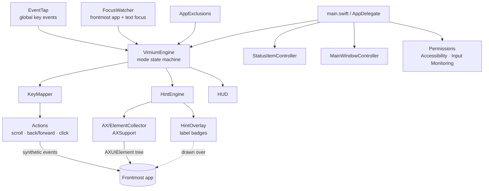

# Architecture

A native macOS menubar app (no Dock icon) that adds Vimium-style keyboard navigation to any app via the Accessibility API and a global event tap.

| Module | Role |
|---|---|
| `EventTap` | Intercepts and swallows/passes keystrokes |
| `FocusWatcher` | Switches to insert mode when a text field has focus |
| `AX/` | Walks the accessibility tree to find clickable elements |
| `Hints/` | Generates labels and renders overlay |
